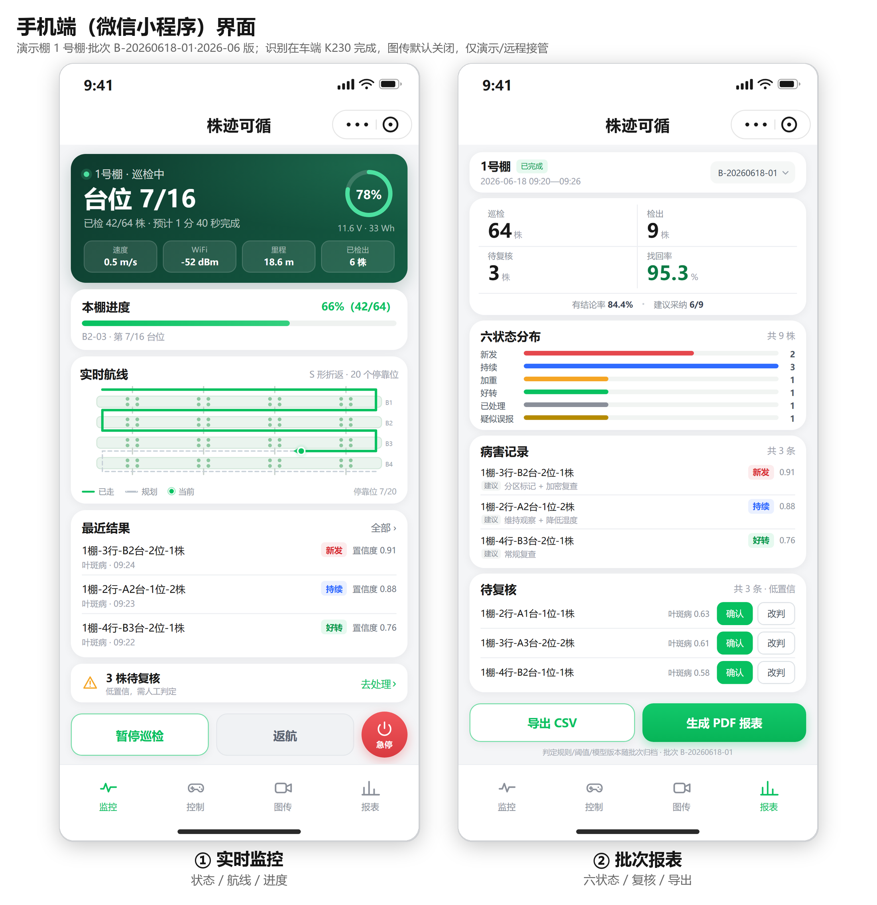
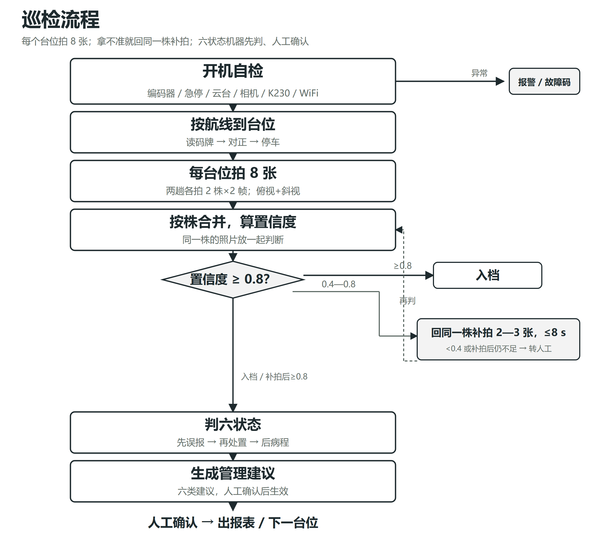
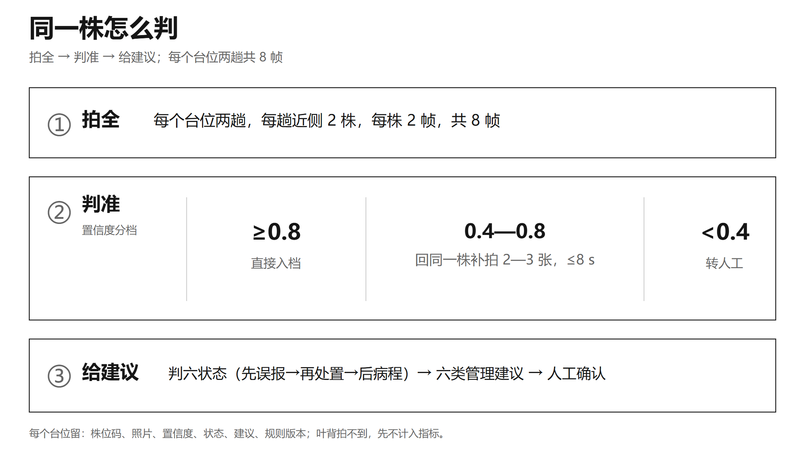
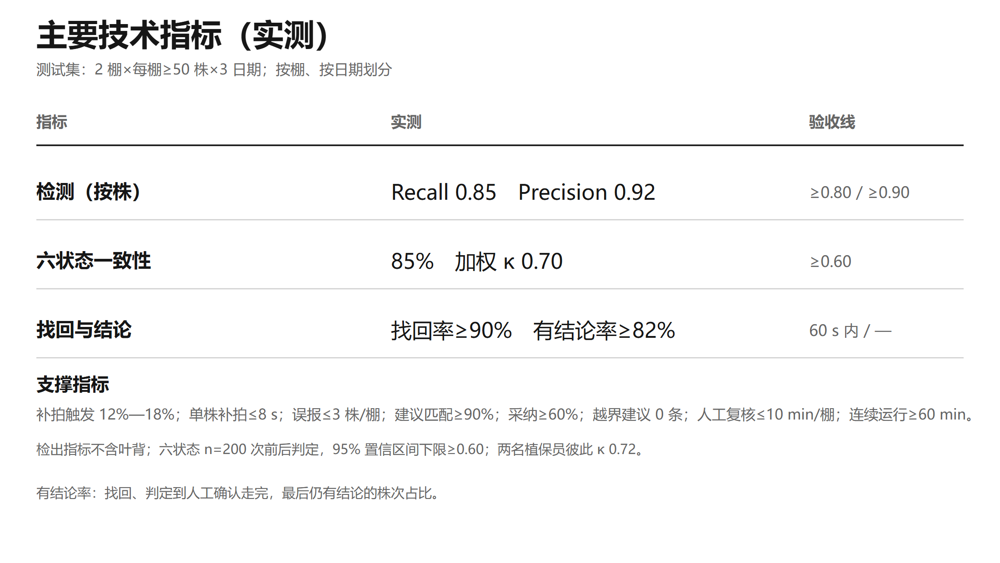
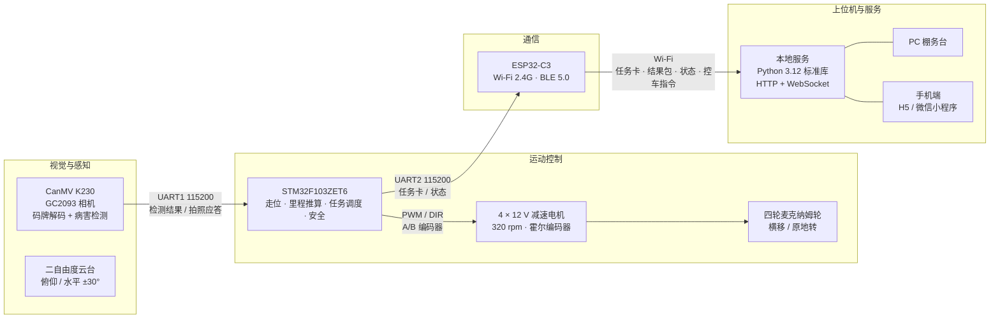
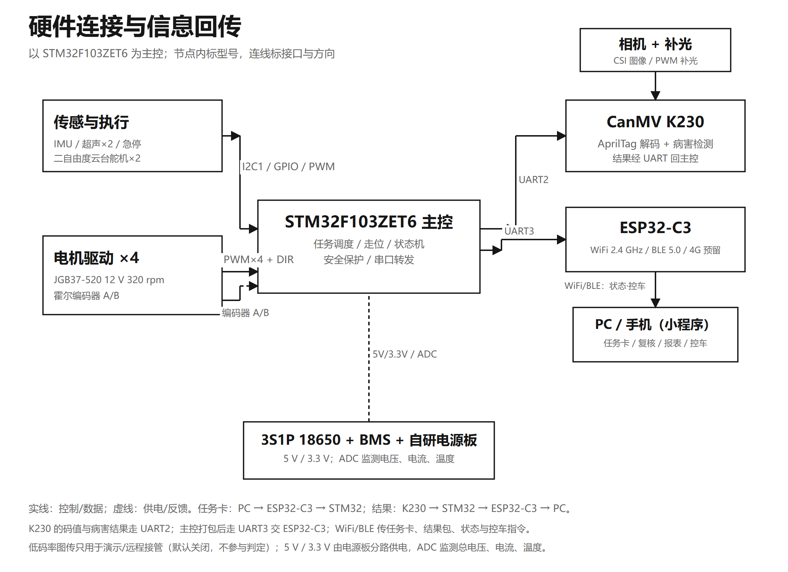
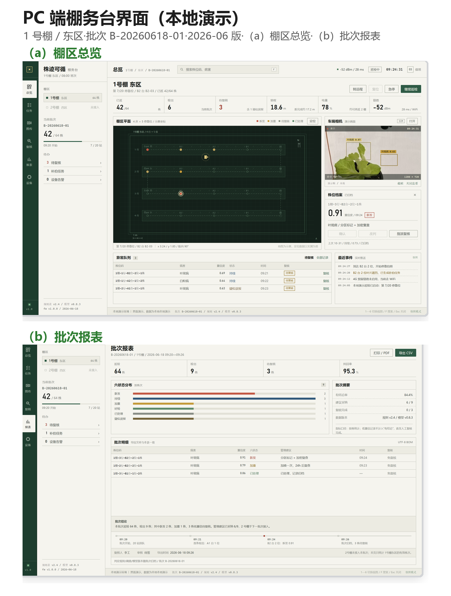
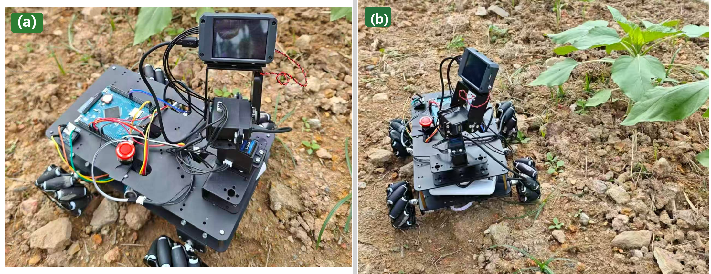

<div align="center">

<h1>株迹可循 · PlantTrace</h1>

<h3>面向「一株一档」的温室巡检与病害追溯智能机器小车</h3>

<p><strong>给每一株苗一个固定编号 —— 让每一次巡检，都能回到同一株。</strong></p>

<p>
  <a href="code/demo/server"></a>
  <a href="code/demo/web"></a>
  <a href="docs/02-system-architecture.md"></a>
  <a href="LICENSE"></a>
  
</p>



</div>

---

> **项目负责人 / Project Lead：[@anhaoXie](https://github.com/anhaoXie)**
> 负责总体方案设计、技术路线、系统集成与整机联调；本仓库由项目负责人整理并发布。
> 团队成员与分工见 [docs/10-team-and-roles.md](docs/10-team-and-roles.md)（仅公开角色，不公开个人信息）。

## 目录

- [1. 这个项目解决什么问题](#1-这个项目解决什么问题)
- [2. 核心思路：一株一档](#2-核心思路一株一档)
- [3. 核心创新](#3-核心创新)
- [4. 关键指标](#4-关键指标)
- [5. 系统架构](#5-系统架构)
- [6. 仓库结构](#6-仓库结构)
- [7. 快速开始](#7-快速开始)
- [8. 文档索引](#8-文档索引)
- [9. 数据与模型口径](#9-数据与模型口径)
- [10. 边界与不适用](#10-边界与不适用)
- [11. 团队与分工](#11-团队与分工)
- [12. 研发历程](#12-研发历程)
- [13. 许可、引用与致谢](#13-许可引用与致谢)
- [14. 脱敏声明](#14-脱敏声明)

---

## 1. 这个项目解决什么问题

小型温室/苗圃的日常巡检有三个长期存在的麻烦，它们看起来分散，其实卡在同一个地方。

| 麻烦 | 现场表现 |
|---|---|
| **看不准** | 相机吊在顶上、一个台位只拍一张俯视图：心叶被外叶包着，下部叶和叶柄基部贴着基质，叶背朝下，病斑容易被挡住。换棚、隔几天，光照与株型一变，准确率继续掉。 |
| **说不清** | 巡检结果只有「有病/没病」，顶多给一个病害框；同一株这次比上次是**新发、持续、加重还是好转**，没有统一口径，三天后只能靠相册和记忆判断。 |
| **用不上** | 看到「疑似病害」之后，是否隔离、通风、降湿、清除病叶、加密复查，仍要工作人员凭经验决定；检测结果与田间动作之间缺一段衔接。 |

三个问题的共同短板是：**记录里没有「株」这个主键。**
回不到同一株，前后两张照片就不是同一株的两个时刻，状态变化无从判断；准确率也只能报数据集平均分，漏了谁、误报了谁查不出来。

> 参考文献中的一组对照很说明问题：Ouyang 等（2022）在温室番茄上，随机划分数据时 Recall 85.2%，改成按拍摄日期划分后只剩约 69.8%——换天巡检的掉点，是真实存在的。

## 2. 核心思路：一株一档

本作品先解决「回到同一株」，再谈识别与建议：

1. **建码**：每株苗一个五级株位码 `棚—行—台—位—株`，台位内 4 株按固定方位（西南/东南/西北/东北）编号，两侧同号。
2. **巡检**：麦轮底盘沿 S 形航线逐台位停靠，每个台位在两侧过道各停一次，每次拍近侧 2 株，每株拍俯视 + 斜视各 1 帧，**一个台位合计 8 帧**。
3. **判定**：一株的多帧先并成一条检测结论；置信度 0.4—0.8 的株回同一停靠位补拍 2—3 张；再按固定顺序判**六状态**。
4. **建议**：按「状态 × 严重度 × 生育期」查规则表，输出六类农事动作建议（不给药名、浓度、剂量）。
5. **复查**：隔天/换人按任务卡回原株，60 s 内到株，前后照片并排核对；改判留痕。

<div align="center">

<br><em>图 1(b) 巡检主流程：自检 → 逐台位多角度拍摄 → 检测 → 补拍 → 六状态 → 建议 → 人工确认 → 报表</em>
</div>

## 3. 核心创新

**本作品不自称「全新检测算法」。** 创新在系统层：把原本断开的**检测、状态变化、管理建议**三条线，接到同一株的档案上。

| 层级 | 做法 | 可检验的东西 |
|---|---|---|
| **核心** | 一株一档：固定株位码作为主键，照片、置信度、六状态、建议、操作人全部挂在同一个编号下 | 每次结论能逐株回溯到照片与规则版本 |
| **支撑一** | 不依赖 RTK 的三层定位：台位层（AprilTag 同号码牌）、连续层（轮式里程计 + IMU）、株位层（固定方位编号） | 同台位停 10 次偏差 ≤ 5 cm；跨日期找回率 ≥ 90%，单株 ≤ 60 s |
| **支撑二** | 拿不准就回同一株补拍；六状态按「先误报、再处置、后病程」固定顺序判定 | 补拍触发率 12%—18%；六状态与两名植保员盲判一致率 85%、加权 κ 0.70 |

<div align="center">

<br><em>图 4 同一株怎么判：看前后证据 → 判六状态 → 给管理建议 → 人工确认</em>
</div>

### 六状态判定（固定顺序）

1. **先看误报**：人工否定，或前后照片对不上、解释不了 → `疑似误报`
2. **再看处理记录**：有处理记录且检出下降 → `已处理`
3. **最后看病程**：病斑面积比 `r = S₂ / S₁`（只用顶视照片计算）
   - 首次检出 → `新发`
   - `r ≥ 1.2` → `加重`
   - `0.8 < r < 1.2` → `持续`
   - `r ≤ 0.8` → `好转`

阈值由同一株、同一停靠位重复拍摄的误差（3σ）确定，要求 `r` 的波动 ≤ 5%；机器给初判、置信度和依据照片，**最终由人确认，改判留痕**。

### 六类管理建议

分区标记与操作顺序 · 加密复查 · 通风降湿 · 清除病残体与工具消毒 · 控氮控水 · 取样送检

> 不给药名、浓度、剂量，也不替代植保员；拿不准、跨类冲突或疑似检疫性问题一律转人工。

## 4. 关键指标

> **口径说明**：下表为作品验收口径，检测按**株**统计，测试集为 2 棚 × 每棚 ≥ 50 株 × 3 日期（按棚、按日期划分），原始测试记录随项目材料归档。公开数据集上的**可复现基线**另行标注（见第 9 节），两者不混用。

| 类别 | 指标 | 结果 | 验收线 |
|---|---|---|---|
| 检测 | 按株 Recall / Precision | **0.85 / 0.92** | ≥ 0.80 / ≥ 0.90 |
| 六状态 | 与两名植保员独立盲判一致率 / 加权 κ | **85% / 0.70**（n = 200） | κ ≥ 0.60 |
| 找回 | 跨日期找回率 / 单株找回时间 | **≥ 90% / ≤ 60 s** | ≥ 90% / ≤ 60 s |
| 定位 | 同台位停靠 10 次最大偏差 / 株号正确率 | **≤ 5 cm / ≥ 95%** | ≤ 5 cm / ≥ 95% |
| 结论 | 有结论率 | **≥ 82%** | ≥ 82% |
| 建议 | 与植保员动作集匹配率 / 采纳率 / 越界建议 | **≥ 90% / ≥ 60% / 0 条** | ≥ 90% / — / 0 条 |
| 复核 | 人工复核耗时 / 误报 | **≤ 30 s/株 / ≤ 3 株每棚次** | ≤ 30 s / ≤ 3 株 |
| 成本 | 新增已列价器件 / 整机目标售价 | **1,149 元 / ≤ 1.8 万元** | — |

<div align="center">

<br><em>图 7 主要技术指标（实测口径）</em>
</div>

## 5. 系统架构

整机分五块：**底盘、主控、视觉、通信、电源**。



<div align="center">

<br><em>图 1(a) 整机硬件组成与通信关系（装配后）</em>
</div>

### 关键设计

- **底盘**：四轮麦克纳姆轮 + 4 台 12 V 减速电机（320 rpm，霍尔编码器），限速 ≤ 0.8 m/s；巡检 0.5 m/s，对位 0.1 m/s；急停按钮 + 2 路超声波避障。
- **视觉**：CanMV K230 装在顶架二自由度云台上，吊装高度布场时按株高调定；码牌识别与病害检测分工拍摄，结果按株位码归并。
- **通信**：ESP32-C3 以 Wi-Fi 回传为主（任务卡、结果包、状态、控车指令；4G 预留）；低码率图传仅用于监看/远程接管，默认关闭，不参与判定。
- **电源**：3S1P 18650（约 11.1 V / 3 Ah / 33 Wh），两组共 6 节轮换；自研电源板输出 5 V、3.3 V 等，监测电压/电流/温度。
- **安全**：2.4G 遥控优先；失联 500 ms 内停车；急停硬件优先；手机端行驶控制只在「远程模式」开放。

## 6. 仓库结构

```text
.
├─ README.md                     # 本文件
├─ LICENSE                       # MIT
├─ THIRD_PARTY_NOTICES.md        # 第三方组件与数据许可
├─ docs/                         # 设计与评测文档（14 篇）
│  ├─ 01-overview.md             # 项目概述与问题定义
│  ├─ 02-system-architecture.md  # 整机与软件架构
│  ├─ 03-plant-level-record.md   # 一株一档、五级株位码、三层定位
│  ├─ 04-six-state-and-advice.md # 六状态判定与管理建议
│  ├─ 05-route-and-imaging.md    # 航线、覆盖与成像判据
│  ├─ 06-detection-and-datasets.md
│  ├─ 07-metrics.md              # 指标定义、评测口径与结果
│  ├─ 08-software-and-demo.md    # 软件栈、接口与演示
│  ├─ 09-market-and-business.md  # 适用场景、成本与商业模式
│  ├─ 10-team-and-roles.md       # 团队分工（脱敏）
│  ├─ 11-boundaries-and-compliance.md
│  ├─ 12-roadmap-and-history.md
│  ├─ references.md
│  └─ figures/                   # 设计图（图 1—图 12）
├─ code/
│  ├─ demo/                      # 可运行演示：H5 / PC / 小程序 / 服务端 / K230 固件
│  ├─ training/
│  │  ├─ model/                  # 前期 EI 论文算法复现代码（AICM + YOLO11n）
│  │  ├─ datasets/               # 公开数据集下载、清洗、重划分脚本
│  │  └─ bokchoy-baseline/       # 公开数据基线训练产出（曲线 + 结果）
│  └─ samples/                   # 16 张测试样例 + 真实推理画框结果
└─ .gitignore
```

## 7. 快速开始

### 7.1 本地演示（手机端 + PC 端，无需第三方依赖）

```bash
cd code/demo
python server/app.py
# 手机端 H5： http://127.0.0.1:8765/
# PC 棚务台： http://127.0.0.1:8765/pc/
```

Windows 用户可直接双击 `code/demo/启动演示.cmd` / `启动PC演示.cmd`。

演示动线：**监控**（台位/电量/航线/最近结果）→ **控制**（切远程模式 → 摇杆 → 急停）→ **图传**（K230 实拍 / 检测框）→ **报表**（KPI / 六状态 / 复核 / 导出 CSV）。

<div align="center">

<br><em>图 12 PC 端棚务台：（a）棚区总览；（b）批次报表</em>
</div>

### 7.2 微信小程序（可选）

用微信开发者工具导入 `code/demo/miniprogram`，测试号即可编译；无服务端时使用内置 mock 数据。真机 BLE 控车与 HTTPS 合法域名属于二期，见 [docs/08-software-and-demo.md](docs/08-software-and-demo.md)。

### 7.3 K230 板端（可选）

`code/demo/firmware/k230/` 提供：

- `detect_yolo11.py`：K230 摄像头取帧 → kmodel 推理 → 屏幕画框（**已在 CanMV K230 YAHBOOM-1G + CanMV v1.4.3 + GC2093 上跑通**，见 `board_verify.jpg`）
- `best_320.kmodel`：YOLO11n 320×320 int8 PTQ 模型（2.93 MB，nncase 2.11.0 / K230 target）
- `push_frames.py` / `mjpeg_server.py`：图传上行与 MJPEG 服务（联调用）

上板步骤与排错见 `firmware/k230/K230上板说明.md`。

### 7.4 训练与复现（可选，需要 ultralytics 环境）

```bash
cd code/training/datasets
python download_datasets.py
python prepare_bokchoy.py    # 按原图基名分组，重划 70/15/15，避免增强副本跨集泄漏
# 训练命令与结果见 code/training/bokchoy-baseline/README.md
```

公开数据基线的可复现结果：YOLO11n / 320 px / 8 epochs / CPU，验证集 **P 0.674、R 0.544、mAP@50 0.579、mAP@50-95 0.328**——仅用于验证「数据—训练—导出」链路，**不作为作品指标**。

## 8. 文档索引

| 文档 | 内容 |
|---|---|
| [01 项目概述](docs/01-overview.md) | 问题、思路、创新点、适用范围 |
| [02 系统架构](docs/02-system-architecture.md) | 硬件五块、软件四层、通信协议、数据流 |
| [03 一株一档与定位](docs/03-plant-level-record.md) | 五级株位码、三层定位、找回流程 |
| [04 六状态与建议](docs/04-six-state-and-advice.md) | 判定顺序、阈值、建议规则表与边界 |
| [05 航线与成像](docs/05-route-and-imaging.md) | S 形分幅航线、覆盖判据、GSD/仰角 |
| [06 检测与数据集](docs/06-detection-and-datasets.md) | 多角度、补拍、数据来源、泄漏分析、K230 部署 |
| [07 指标与评测](docs/07-metrics.md) | 指标定义、测试集、统计口径、结果 |
| [08 软件与演示](docs/08-software-and-demo.md) | H5/PC/小程序/服务端/接口，演示脚本 |
| [09 市场与产业化](docs/09-market-and-business.md) | 目标客户、成本结构、三种合作方式 |
| [10 团队与分工](docs/10-team-and-roles.md) | 项目负责人与角色分工（脱敏） |
| [11 边界与合规](docs/11-boundaries-and-compliance.md) | 不适用场景、安全约束、数据与伦理 |
| [12 研发历程](docs/12-roadmap-and-history.md) | 里程碑、版本演进、后续计划 |
| [13 选题与方向调研](docs/13-research-and-selection.md) | 五方向比较、证据分级、为什么选「一株一档」 |
| [参考文献](docs/references.md) | 9 篇核心文献与数据集许可 |

## 9. 数据与模型口径

本仓库刻意区分三类证据，避免把不同来源的数字混为一谈：

| 层级 | 内容 | 可复现性 |
|---|---|---|
| **作品验收指标** | 2 棚 × ≥50 株 × 3 日期的按株检测、六状态一致率、找回率等 | 原始测试记录随项目材料归档，不在本仓库重复分发 |
| **公开数据基线** | Bok Choy 数据集 1,965 张（2 类），按原图分组重划 1,402/286/277；YOLO11n 320 px / 8 epochs / CPU | ✅ 本仓库提供全部脚本、曲线与 `results.csv`；权重文件不含在内，按脚本可复现 |
| **K230 板端** | int8 kmodel 上板推理，验证「导出—量化—上板」链路 | ✅ kmodel 与推理脚本在仓库内；板端置信度受量化影响，不作为精度依据 |

**数据泄漏的处理**：Bok Choy 公开集 1,965 张只来自 480 张原图（4× 增强），Roboflow 原始划分中有 331/480 组（69%）的增强副本同时出现在 train 与 test。本仓库按「原图基名」分组重划，保证同一原图的所有增强只落在一个 split——这也是作品中「按日期划分 vs 随机划分」论证的工程化体现。

## 10. 边界与不适用

本作品是**窄口径验证**，以下边界主动写清楚：

- **作物**：仅矮脚上海青（1 种）；**病害**：1—2 种外观明显的病害；**棚型**：台架式/垄作小型温室（1 类）。
- **只做已显症植株**，不做早期无症状（公开研究田间无症状株最佳检出约 59.8%）。
- **叶背**当前版本拍不到，结构上预留侧下视机位，本版不计入检出指标。
- **样本**为 2 棚 × 3 日期，跨季、跨品种泛化需继续验证。
- **建议只到农事管理层面**，不给药名、浓度、剂量，不替代植保员。
- **不适用**：露地/坡地、全病害、早期无症状、自动施药、无人值守。

## 11. 团队与分工

> 为保护成员个人信息，本仓库只公开角色与职责，不公开姓名、学号、院校与联系方式。

| 角色 | 人数 | 职责 |
|---|---|---|
| **项目负责人 / Team Lead**（[@anhaoXie](https://github.com/anhaoXie)） | 1 | 总体方案、技术路线、系统集成、整机联调、文档与对外汇报 |
| 硬件与结构 | 2 | 麦轮底盘、主控与电源、云台与结构件、线束与装配 |
| 算法与视觉 | 2 | 检测模型、数据集与评测、K230 部署与量化 |
| 软件与交互 | 2 | 服务端、PC 棚务台、手机端、通信与接口 |
| 测试与农艺协作 | 2 | 棚内实测、六状态标注口径、植保员对照与记录 |

分工详情见 [docs/10-team-and-roles.md](docs/10-team-and-roles.md)。

## 12. 研发历程

| 阶段 | 时间 | 里程碑 |
|---|---|---|
| 前期积累 | 2025 | 轻量化叶病检测方法研究，EI 论文（AIAHPC 2025）发表，形成算法基础 |
| 方案定稿 | 2026-06 | 明确「一株一档」主线，确定整机五块与六状态口径 |
| 器件与样机 | 2026-07 — 08 | 选型采购、样机装配、底盘与云台联调 |
| 整机联调 | 2026-09 | 逐台位停靠拍照、同一台位重复停靠 10 次流程验证；2026-09-18 外场功能演示 |
| 数据与软件 | 2026-10 | 数据集管线、六状态规则、PC/手机端演示、K230 图传与板端推理 |
| 开源整理 | 2026-11 | 代码与文档脱敏、仓库结构整理、公开基线复现 |

<div align="center">

<br><em>图 9 在农业用地完成整机行走、图传与图像采集的外场功能演示（2026-09-18）</em>
</div>

## 13. 许可、引用与致谢

- 本仓库代码与文档采用 **MIT License**（见 [LICENSE](LICENSE)）。
- `code/training/` 中的训练脚本依赖 [Ultralytics](https://github.com/ultralytics/ultralytics)（**AGPL-3.0**）；使用、修改或再分发时请遵守其许可证。
- 公开数据集 **Bok Choy（CC BY 4.0）** 与 **PlantDoc（CC BY 4.0）** 的来源、修改说明见 [THIRD_PARTY_NOTICES.md](THIRD_PARTY_NOTICES.md)。
- 感谢指导教师在方案与农艺口径上的建议，感谢合作棚区提供的实测场地。

如果本仓库对你的研究或工程有帮助，欢迎引用本仓库的参考文献，或在 Issues 中交流。

## 14. 脱敏声明

本仓库在公开前做了系统性脱敏处理：

- 不含姓名（项目负责人以 GitHub 账号标识）、学号、院校、学院、联系方式、身份证号等个人信息；
- 不含竞赛申报书、汇总表、证书、评审材料等原始文件；
- 不含真实 Wi-Fi 账号/密码/设备 token（代码中均为 `YOUR_SSID` / `YOUR_PASSWORD` 等占位值）；
- 演示数据为仿真检查点或公开数据集样例，不含真实温室位置与人员影像。

如发现仍有遗漏，请通过 Issue 联系，我们会第一时间处理。
