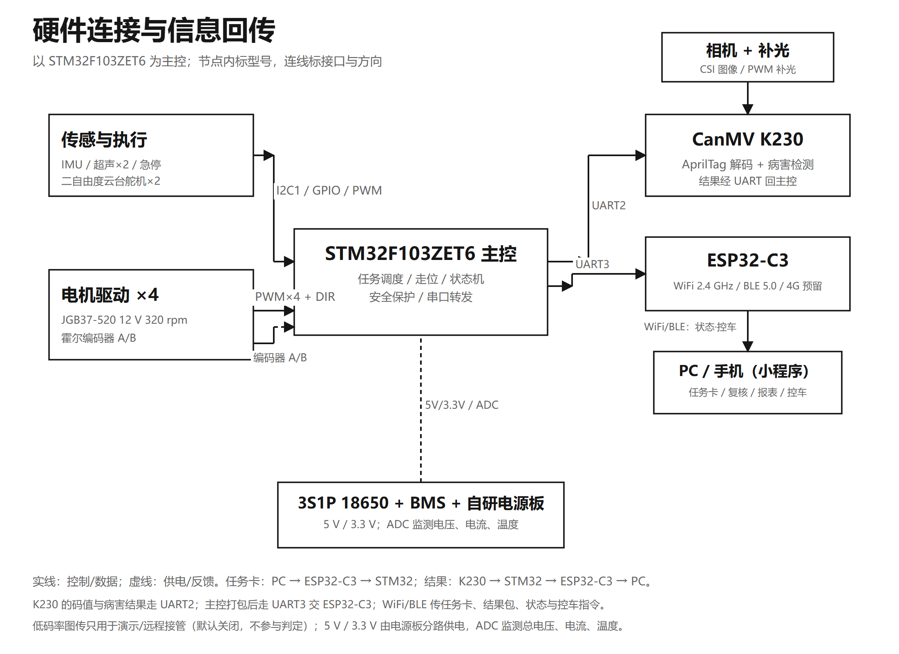

# 02 · 系统架构

## 1. 整机五块

| 模块 | 关键器件 | 职责 | 接口 |
|---|---|---|---|
| **底盘** | 四轮麦克纳姆轮；4 × 12 V 减速电机（320 rpm，霍尔编码器） | 横移、原地转、低速对位；限速 ≤ 0.8 m/s | PWM/DIR；A/B 编码器反馈 |
| **主控** | STM32F103ZET6 系统板 | 走位、里程/IMU 推算、任务调度、安全保护 | UART1 ↔ K230；UART2 ↔ ESP32-C3；SPI/I²C ↔ 传感器 |
| **视觉** | CanMV K230 + GC2093 相机；二自由度云台（俯仰 + 水平） | 码牌解码、病害检测、拍照应答 | CSI-2 相机；UART1 115200 · 3.3 V TTL |
| **通信** | ESP32-C3（Wi-Fi 2.4G + BLE 5.0；4G 预留） | 任务卡下发、结果包回传、状态上报、控车指令 | UART2 115200；Wi-Fi TCP/HTTP/WS |
| **电源** | 3S1P 18650（约 11.1 V / 3 Ah / 33 Wh），两组共 6 节轮换；自研电源板 | 5 V / 3.3 V 多路输出；电压、电流、温度监测 | 硬件急停 / 驱动使能 |

辅助与安全：急停按钮（常闭硬件安全回路）、2 路超声波避障（前左/前右）、IMU、RC522、HC-SR04、摄像头补光灯（MOSFET 驱动）。

<div align="center">

<br><em>图 1(a) 整机硬件组成与通信关系（装配后）</em>
</div>

## 2. 软件四块

| 层 | 运行位置 | 负责什么 | 不负责什么 |
|---|---|---|---|
| **车端运动控制** | STM32F103ZET6 | 按任务卡顺序走位；编码器里程 + IMU 推算；到点给 K230 拍照信号；盯急停、超声波、码牌状态；越界/失联停车报警 | 不做识别 |
| **车端视觉** | CanMV K230 | 解码牌；跑病害检测；结果经串口回主控 | 不做跨次状态与建议 |
| **棚务决策** | PC 端（本地服务 + 棚务台） | 任务卡下发；同株多帧并成一条结论；补拍决策；六状态；建议；存档与报表 | 不做实时运动控制 |
| **现场复核** | 手机端（H5 / 微信小程序） | 看实时状态、低码率图传、批次报表；逐株确认/改判；远程模式下近场控车 | 图传不参与判定 |

> 识别仍在车端完成，**图传只用于监看和远程接管，不参与判定**；手机端行驶控制只在「远程模式」开放。

## 3. 数据流

```
任务卡 (PC → ESP32 → STM32)
    ↓
STM32 走到台位 → 读码牌 + 对正 → 发拍照信号 → K230 取帧
    ↓
K230: 码牌解码 / 病害检测 → UART1 → STM32
    ↓
STM32 + ESP32: 结果包 (株位码、帧号、检测框、置信度、状态) → 本地服务
    ↓
本地服务: 按株归并 → 补拍判定 → 六状态 → 建议 → 存档
    ↓
PC 棚务台 / 手机端: 展示、复核、改判、导出 CSV
```

### 帧的组织方式

| 帧类型 | 内容 | 用途 |
|---|---|---|
| 定位帧 | 只读码牌、把车身对正 | 停靠与株位码绑定 |
| 检测帧 | 俯视 1 + 斜视 1，每株 2 帧 | 病害检测与病斑面积比 |
| 补拍帧 | 同停靠位、云台 ±30° 再拍 2—3 张 | 低置信度复核 |

一个台位分两趟拍完：一条过道拍近侧 2 株，另一条过道拍另外 2 株；每株 2 帧，合计 **8 帧/台位**。定位帧与检测帧分工拍摄，互不干扰；同一株的多帧按株位码归并，同一处病害取最清楚的一张。

## 4. 通信与协议

### 4.1 硬件链路

| 链路 | 参数 | 方向 | 内容 |
|---|---|---|---|
| K230 ↔ STM32 | UART1 · 115200 · 3.3 V TTL | 双向 | 拍照信号、检测结果、状态 |
| STM32 ↔ ESP32-C3 | UART2 · 115200 · TTL | 双向 | 任务卡、结果包、状态、控制 |
| ESP32-C3 ↔ 局域网 | Wi-Fi 2.4G | 双向 | HTTP / WebSocket |
| K230 ↔ PC（图传） | Wi-Fi | 单向推流 | `POST /api/device/frame`、MJPEG/RTSP |
| 4G | 预留 | — | 远程运维（本期不启用） |

### 4.2 业务协议（预留）

`0x30 TEL`（遥测） / `0x31 EVENT`（事件） / `0x40 PCMD`（底盘控制） / `0x41 TASK`（任务） / `0x50 BCMD`（BLE 控制） / `0x51 BSTATE`（BLE 状态）。

服务端本地接口契约见 [`code/demo/docs/api_contract.md`](../code/demo/docs/api_contract.md) 与 [`code/demo/docs/K230_实时图传_API.md`](../code/demo/docs/K230_实时图传_API.md)。

## 5. 一次巡检的状态机

```
开机自检 ──(任一项失败)──→ 报警 + 故障码（不带故障下地）
   │ 全部通过
   ▼
按 S 形航线走到台位 → 读码牌 → 位置校正 → 停稳
   │
   ▼
拍本侧 2 株（俯视+斜视）→ 检测 → 置信度判定
   │
   ├─ ≥ 0.8 ─────────────→ 入档
   ├─ 0.4—0.8 → 回同一停靠位、云台 ±30° 补拍 2—3 张
   │              ├─ 置信度 ≥ 0.8 → 入档
   │              └─ 补满 3 张 / 累计 8 s 仍不足 → 转人工
   └─ < 0.4 ─────────────→ 转人工
   │
   ▼
调出上次照片与处理记录 → 判六状态 → 生成建议 → WiFi 上报 PC
   │
   ▼
本棚走完 → 出报表（PC 与设备各存一份） → 下一棚
```

码牌读不到时：先换云台角度重试同一张，再读同号另一侧（≤ 3 次）；仍不行用里程计推算；再不行把该台位标成「码牌待查」，继续巡检，出棚后人工补。

## 6. 安全设计

| 约束 | 实现 |
|---|---|
| 急停优先 | 硬件常闭安全回路，按下即断驱动 |
| 遥控优先 | 2.4G 遥控器优先级高于任何软件控制 |
| 失联停车 | 与上位机/遥控失联 500 ms 内停车 |
| 远程模式闸门 | 手机端控车必须先切「远程模式」，且只在近场使用 |
| 限速 | 底盘限速 ≤ 0.8 m/s；巡检 0.5 m/s；对位 0.1 m/s |
| 避障 | 2 路超声波，越界报警 |
| 不带故障下地 | 开机自检不通过即报警 + 故障码 |

## 7. 代码映射

| 架构组件 | 仓库位置 |
|---|---|
| K230 视觉与图传 | [`code/demo/firmware/k230/`](../code/demo/firmware/k230/) |
| 本地服务（仿真 / HTTP / WebSocket / 报表 / 设备接入） | [`code/demo/server/`](../code/demo/server/) |
| PC 棚务台 | [`code/demo/web_pc/`](../code/demo/web_pc/) |
| 手机端 H5 与微信小程序骨架 | [`code/demo/web/`](../code/demo/web/)、[`code/demo/miniprogram/`](../code/demo/miniprogram/) |
| 设备模拟器（无硬件联调） | [`code/demo/tools/device_simulator.py`](../code/demo/tools/device_simulator.py) |
| 检测模型训练与数据管线 | [`code/training/`](../code/training/) |

> **范围说明**：车端 STM32 运动控制固件与 ESP32-C3 通信固件在整机侧维护，未包含在本仓库；本仓库覆盖视觉端、服务端、上位机/移动端与算法数据工程。
