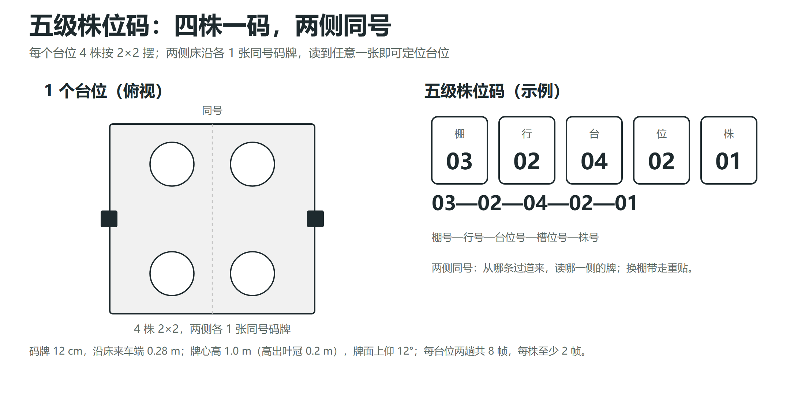
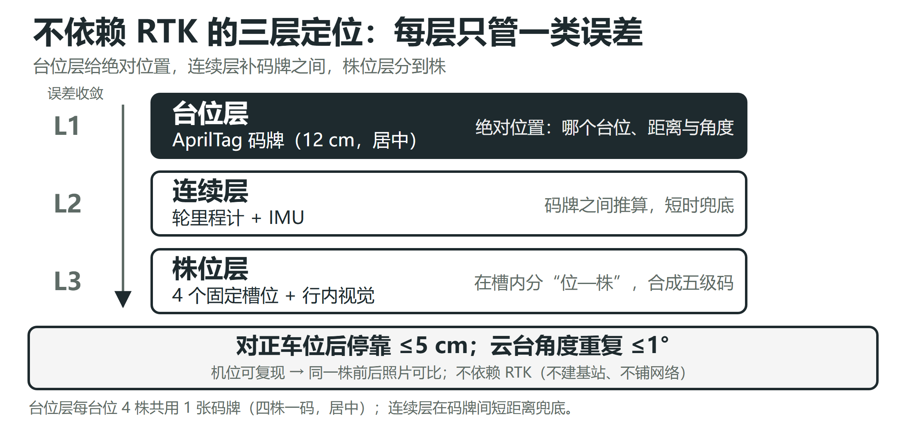

# 03 · 一株一档：五级株位码与三层定位

> 这是整个作品的地基：**先能回到同一株，准确率才谈得上。**

## 1. 为什么主键必须是「株」

巡检记录里如果只写「第几行、大概几株」，三天后只能靠记忆和相册翻：

- 回不到同一株 → 前后两张照片不是同一株的两个时刻，**新发还是加重无法判断**；
- 状态判不出 → 建议只能凭印象给；
- 准确率只能报数据集平均分 → **漏了谁、误报了谁查不出来**。

所以本作品把「株」做成记录的主键：位置、照片、置信度、六状态、建议、操作人全部挂在同一个株位码下。

## 2. 五级株位码

```
棚 — 行 — 台 — 位 — 株
B1   02   04   SW   02
```

| 层级 | 含义 | 编号方式 |
|---|---|---|
| 棚 | 温室编号 | 布场时录入 |
| 行 | 苗床编号 | 沿棚长方向顺序 |
| 台 | 台位编号 | 每床 4—6 个台位 |
| 位 | 台位内 4 个方位 | **固定方位**：西南 / 东南 / 西北 / 东北（不按离车远近编） |
| 株 | 位内株序号 | 每台位 4 株，2×2 摆放 |

> 台位 = 一组 2×2 摆放的 4 株；「四株一码」指每个台位一个台位码，台位内 4 株再按方位区分。

<div align="center">

<br><em>图 3 五级株位码：四株一码，两侧同号</em>
</div>

## 3. 码牌布置

- **码制**：AprilTag TAG36H11，12 cm 见方，编号带「棚—行—台」。
- **数量**：每个台位苗床**两侧边缘各贴 1 张同号码牌**，从任一条过道来都能读到近侧的牌。
- **位置**：来车方向前端 0.28 m；牌心高 1.0 m、高出叶冠 0.2 m；牌面上仰 12°。
- **成本**：纸片 + 3D 打印短杆约 20—40 元/棚，演示棚 32 张（16 台位 × 两侧），未计入 1,149 元 BOM。

## 4. 三层定位：每层只负责一类误差

不依赖 RTK（要建基站、要联网，棚里用不上），把定位误差分层控制：

| 层 | 手段 | 负责的误差 | 精度 |
|---|---|---|---|
| **L1 台位层** | AprilTag 同号码牌 + 云台读码 | 我在哪个台位、车身偏了多少 | 停靠偏差收进 ≤ 5 cm |
| **L2 连续层** | 轮式里程计 + IMU | 码牌之间短时丢失兜底 | 短时推算，到台位即校正 |
| **L3 株位层** | 台位内固定方位编号 + 记录 | 台位内是哪一株 | 与株位码一一对应 |

<div align="center">

<br><em>图 5 不依赖 RTK 的三层定位</em>
</div>

**读码失败的降级链**：换云台角度重试同一张 → 读同号另一侧（≤ 3 次）→ 里程计推算 → 仍不行标「码牌待查」继续巡检，出棚后人工补。**不为一张码牌卡住整条航线。**

## 5. 跨日期找回流程

```
任务卡（目标株位码）
   ↓
按坐标先验找到台位（±15 cm 内搜码牌）
   ↓
读到码牌 → 位置校正（停靠误差 ≤ 5 cm）
   ↓
按码查档 → 调出该株历史照片与记录
   ↓
对图核对（外观校验）→ 前后两张并排
   ↓
人工确认 → 写回档案
```

| 指标 | 结果 |
|---|---|
| 跨日期找回率（2 棚 × ≥50 株 × 3 日期，60 s 内到株并人工确认） | ≥ 90% |
| 单株找回时间 | ≤ 60 s |
| 同台位停靠 10 次最大偏差 | ≤ 5 cm |
| 株号正确率（人工核对 200 个株位码） | ≥ 95% |

## 6. 与航线的配合

找回不是独立动作，它嵌在巡检航线里：每个台位在两侧过道各停一次，**停靠位固定、拍摄角度固定**，同一株的俯视/斜视帧在每次巡检中可复现。这样「找回」才能支撑「前后对比」——不只是走到同一株旁边，而是**以同样的机位再看它一次**。

航线与覆盖判据见 [05 航线与成像](05-route-and-imaging.md)。

## 7. 为什么不用 RTK

| 原因 | 说明 |
|---|---|
| 成本 | RTK 需要基站 + 流动站，整机成本上去 |
| 改造 | 小型旧棚不愿为定位做土建/供电改造 |
| 遮挡 | 棚内结构、作物对卫星信号不友好 |

代价是绝对精度不如 RTK，所以把误差分层：**台位一层、码牌之间一层、株位一层，每层只负责一类误差**。这也换来了可换棚复用——码牌带走重贴即可，不改温室结构。
