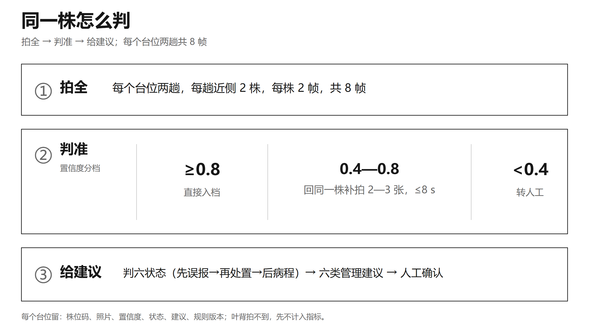

# 04 · 六状态判定与管理建议

> 状态是判出来的结果，建议是给出去的动作。两者都必须能追到株位码、依据照片与规则版本。

## 1. 为什么需要六状态

巡检结果如果只有「有病害/没有病害」，三天后回看时无法回答两个关键问题：

- 这株是**新发**，还是**加重**，还是**好转**？
- 上次已经处理过的，这次算「已处理」还是「疑似误报」？

「已处理」是管理记录，「疑似误报」是检查结论——两者混在一起就没法统计。因此本作品把同一株的状态拆成六类，并规定**固定判定顺序**。

## 2. 六状态定义

| 状态 | 含义 | 判据 |
|---|---|---|
| `疑似误报` | 检查结论：不是真病害 | 人工否定；或前后照片对不上、解释不了 |
| `已处理` | 管理记录：已采取过措施 | 有处理记录且检出下降 |
| `新发` | 首次检出 | 该株历史上无病害记录，本次检出 |
| `加重` | 病斑面积比上升 | `r = S₂/S₁ ≥ 1.2` |
| `持续` | 病斑面积比基本不变 | `0.8 < r < 1.2` |
| `好转` | 病斑面积比下降 | `r ≤ 0.8` |

其中 `S₁`、`S₂` 分别为前后两次巡检中**同一株**的病斑像素面积；`r` 只用**顶视照片**计算，斜视照片只作补充证据。

## 3. 固定判定顺序

```
① 先看是不是误报
   人工否定，或前后照片对不上、解释不了 → 疑似误报
        ↓ 否
② 再看有没有处理记录
   有记录且检出下降 → 已处理
        ↓ 否
③ 最后看病程（病斑面积比 r）
   首次检出 → 新发
   r ≥ 1.2  → 加重
   0.8 < r < 1.2 → 持续
   r ≤ 0.8  → 好转
```

<div align="center">

<br><em>图 4 同一株怎么判：看前后证据 → 判六状态 → 给管理建议 → 人工确认</em>
</div>

### 阈值怎么来的

阈值不是拍脑袋定的，而是按**同一株、同一停靠位重复拍摄的误差**来定：

- 重复拍摄要求病斑面积比 `r` 的波动 ≤ 5%（变异系数 CV ≤ 5%）；
- 分段阈值取重复误差的 3σ；
- 规则、阈值、模型版本**按巡检批次归档**；人工改判回流到难例库，按周更新。

## 4. 人工确认与留痕

- 机器给初判、置信度与依据照片；
- 人工在 PC 棚务台或手机端逐株确认/改判；
- 改判记录包含：原状态、新状态、操作人、时间、依据照片、规则版本；
- 同一批数据换个时间再跑，结论应对得上（可复现）。

## 5. 管理建议：从状态到动作

### 5.1 规则表

按 **状态 × 严重度 × 生育期** 查一张管理建议表，输出六类建议：

| 建议类别 | 典型场景 |
|---|---|
| 分区标记与操作顺序 | 先处理病区、后处理健康区，避免交叉 |
| 加密复查 | 状态可疑或新发，缩短复查间隔 |
| 通风降湿 | 高湿型病害风险 |
| 清除病残体与工具消毒 | 已显症、局部病斑 |
| 控氮控水 | 长势过旺、易感期 |
| 取样送检 | 拿不准、疑似检疫性问题 |

### 5.2 边界（写死在规则表里）

- **不给药名、浓度、用量**；
- **不给温湿度、施肥量设定值**；
- 拿不准、跨类冲突、疑似检疫性问题 → **转人工**；
- 建议不替代植保员，最终由人确认后生效，采纳情况留档。

### 5.3 可追溯

每条建议都能追到：

```
株位码 → 依据照片 → 六状态 → 严重度 → 生育期 → 规则版本 → 人工确认记录
```

## 6. 一致性怎么测

| 项目 | 口径 |
|---|---|
| 对照 | 两名植保员独立盲判 |
| 样本 | n = 200 次前后判定 |
| 指标 | 一致率、加权 κ（去掉「碰巧一致」后的吻合度） |
| 结果 | 一致率 **85%**、加权 κ **0.70**；95% 置信区间下限 ≥ 0.60 |
| 上限参照 | 两名植保员彼此 κ **0.72**（机器上限参照，不是目标） |

> 机器不需要、也不应该超过植保员之间的一致性；目标是「可复核、可统计、可追溯」。

## 7. 支撑指标

| 指标 | 结果 |
|---|---|
| 补拍触发率 | 12%—18% |
| 单株补拍耗时 | ≤ 8 s |
| 补拍后置信度中位数提升 | ≥ 0.20 |
| 误报 | ≤ 3 株/棚次（从每棚次 5 株降到 3 株） |
| 建议生成耗时 | ≤ 5 s/株 |
| 建议与植保员动作集匹配率 | ≥ 90% |
| 现场采纳率 | ≥ 60% |
| 越界建议 | 0 条 |
| 人工复核 | ≤ 30 s/株（仅复核预警株 + 10% 抽检，每棚次 ≤ 10 min） |

## 8. 补拍状态机

「拿不准就回同一株补拍」不是一句口号，四件事都写进状态机：

| 环节 | 规则 |
|---|---|
| **触发** | 置信度落在 0.4—0.8；同一株前后两张照片对不上；心叶/下部叶没拍全 |
| **动作** | 回同一株、同一停靠位，云台换 ±30° 再拍 2—3 张 |
| **停止** | 置信度 ≥ 0.8；补满 3 张；单株累计 8 s —— **先到先停** |
| **交人工** | 停不下来，或补完仍不到 0.8，或置信度 < 0.4 |

详见 [06 检测与数据集](06-detection-and-datasets.md)。
