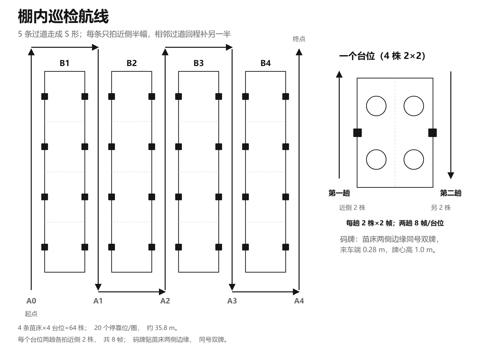

# 05 · 巡检航线与成像判据

## 1. 演示棚的布场参数

| 参数 | 数值 |
|---|---|
| 苗床 | 4 条（B1—B4） |
| 过道 | 5 条（含两侧边道） |
| 每床台位 | 4 个 |
| 台位总数 | 16 个 |
| 每台位株数 | 4 株（2×2） |
| 总株数 | 64 株 |
| 每台位码牌 | 2 张（两侧同号） |
| 停靠位 | 20 个/圈 |
| 单圈路径 | 约 35.8 m |
| 台面宽 | 约 1.0—1.2 m |
| 过道宽 | 约 0.8—1.0 m |

## 2. 为什么航线要「过道分幅」

车在一条过道里走，只能拍到近侧那一面。把云台升到 1.40 m 也拍不清远侧半幅：

| 指标 | 远排实测 | 判据 |
|---|---|---|
| 地面采样距离 GSD | 约 0.81 mm/px | ≤ 0.60 mm/px |
| 有效仰角 | 约 19.6° | ≥ 25° |

因此航线按**过道分幅**：

- 一条过道负责两侧台位的**近侧半幅**；
- 走到棚头折返，进相邻过道，把那一排的另一面补上；
- 5 条过道走成 **S 形**，一圈 20 个停靠位、约 35.8 m；
- 每个台位在两趟里各拍近侧 2 株，合计 8 帧。

<div align="center">

<br><em>图 2 棚内巡检航线：过道分幅，走 S 形；4 条苗床 × 4 台位 = 64 株，20 个停靠位/圈，约 35.8 m</em>
</div>

## 3. 覆盖判据

每株必须同时满足：

| 判据 | 阈值 |
|---|---|
| 帧数 | 每株 ≥ 2 帧 |
| 地面采样距离 | GSD ≤ 0.60 mm/px |
| 有效仰角 | ≥ 25° |
| 可见叶面积 | ≥ 55% |

达不到的株标成「**待补**」，按清单逐株回补；补不到的转人工。**不为几株重跑整条过道。**

## 4. 成像参数的计算

S 形航线的路径长度 `L` 由各停靠点之间的直线段累加：

```
L = Σ |c_i − c_{i−1}|,   i = 1…m
```

地面采样距离与有效仰角：

```
GSD = H · p / f
α   = arctan( H_leaf / d )
```

其中：

- `c_i` 为第 i 个停靠点坐标，`m` 为停靠位数量；
- `H` 为相机到叶面的工作距离，`p` 为像元尺寸，`f` 为焦距；
- `H_leaf` 为叶面相对相机光心的高度差，`d` 为水平距离。

按演示棚参数代入，`GSD ≤ 0.60 mm/px`、`α ≥ 25°` 即对应正文的覆盖判据（每株至少 2 帧、可见叶面积 ≥ 55%）。

## 5. 停靠与拍摄节拍

```
到台位 → 读码牌 → 位置校正 → 停稳
      → 拍本侧 2 株（每株俯视 1 张 + 斜视 1 张）
      → 检测/补拍判定
      → 上报
      → 下一停靠位
```

| 动作 | 说明 |
|---|---|
| 读码 | 来车方向前端 0.28 m、牌心高 1.0 m、高出叶冠 0.2 m、上仰 12° |
| 对正 | 读码后位置校正，停靠误差收进 ≤ 5 cm |
| 拍摄 | 云台俯仰/水平角度按台位标定；每株俯视 + 斜视各 1 帧 |
| 稳定性 | 同台位停 10 次，最大偏差 ≤ 5 cm；云台角度重复 ≤ 1° |

## 6. 为什么不是「一张俯视图走天下」

| 视角 | 能看到 | 看不到 |
|---|---|---|
| 俯视 | 叶面病斑、病斑面积（用于 `r` 计算） | 心叶、下部叶、叶柄基部、叶背 |
| 斜视（±30°） | 被外叶挡住的心叶、贴台面的下部叶与叶柄基部 | 叶背（本版预留侧下视机位） |
| 补拍 | 低置信度/遮挡帧的补充证据 | 仍不足则交人工 |

多角度与补拍带来的提升（同一批测试图）：

| 方案 | 按株 Recall |
|---|---|
| 仅单张顶视 | 0.78 |
| + 多角度 | 0.82 |
| + 补拍 | **0.85** |

误报从每棚次 5 株降到 3 株。详见 [06 检测与数据集](06-detection-and-datasets.md)。

## 7. 与「找回」的关系

航线不是「走完就行」：**停靠位固定、拍摄角度固定**，才是跨次对比的前提。同一株在两次巡检里以同样机位被拍摄，病斑面积比才有意义；否则 `r` 里混入的是视角差，不是病情变化。这也是三层定位（见 [03 一株一档](03-plant-level-record.md)）存在的理由。
