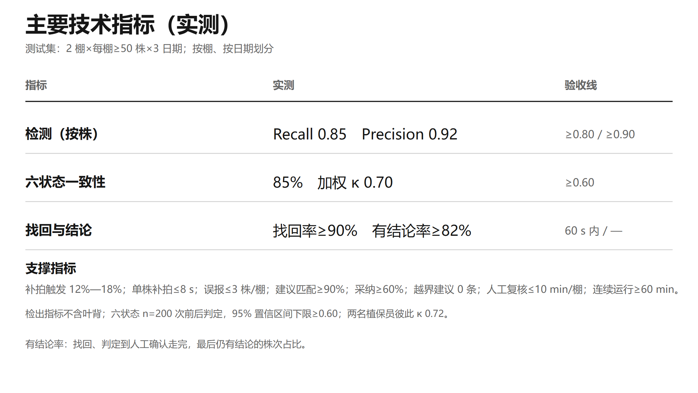

# 07 · 指标与评测口径

> 本页回答三个问题：**测什么、怎么测、结果怎么读**。
> 作品验收指标与公开数据基线严格分开，不混用。

## 1. 测试集

| 项 | 口径 |
|---|---|
| 规模 | 2 棚 × 每棚 ≥ 50 株 × 3 个日期 |
| 划分 | **按棚、按日期划分**（不是随机划分） |
| 阳性样本 | 阳性株 ≥ 80；病斑/病害框 ≥ 300 |
| 复测 | 另加 1 棚 × 20 株 × 2 日期流程复测 |
| 标注对照 | 两名植保员独立盲判（用于六状态一致性） |
| 原始记录 | 统一模板整理，随项目材料归档 |

**为什么按日期划分**：随机划分会让同一棚、同一天的照片同时进训练集和测试集，光照、背景、长势几乎一样，分数虚高；按日期划分，测试那天模型没见过，才接近真实巡检。参考文献中这一落差可达 15 个百分点（Recall 85.2% → 69.8%）。

## 2. 指标定义

### 2.1 检测（按株统计）

```
Recall    = TP / (TP + FN)      # 分母是真病株
Precision = TP / (TP + FP)      # 分母是报出的病株
```

- 同一株的多帧按「取最清楚的一张 + 多角度证据合并」归并为一条按株结论；
- 检出指标**不含叶背**（本版拍不到，已预留机位）。

### 2.2 六状态一致性

- 与两名植保员独立盲判对照；
- 报告**一致率**与**加权 κ**（κ 去掉「碰巧一致」，1 为完全一致）；
- `n = 200` 次前后判定，报告 95% 置信区间下限；
- 两名植保员彼此 κ（0.72）作为**机器上限参照**，不是目标值。

### 2.3 找回率

- 任务卡下发后 **60 s 内**走到目标株并完成人工确认，计成功（含行驶时间）；
- 分母是任务卡里的株数；
- 失败按五类编码：找不到、找错株、超时、地标失败、设备故障。

### 2.4 有结论率

从找回、判定到人工确认走完，最后仍有结论的株次占比。低置信、补拍失败、设备异常都会在这里体现——它比单一检测指标更接近「现场能不能用」。

### 2.5 其他

| 指标 | 定义 |
|---|---|
| 停靠重复误差 | 同一台位停 10 次，取最大绝对偏差 |
| 株号正确率 | 人工核对 200 个株位码 |
| 建议匹配率 | 与植保员独立勾选的动作集合比对 |
| 越界建议 | 出现药名/浓度/剂量，或超出农事管理层面的建议条数 |
| 病斑面积比波动 | 同一株、同一停靠位重复 10 次，`r` 的 CV |
| 连续运行 | 单次充电可持续巡检时长 |

## 3. 结果

| 类别 | 指标 | 结果 | 验收线 |
|---|---|---|---|
| 检测 | 按株 Recall | **0.85** | ≥ 0.80 |
| 检测 | 按株 Precision | **0.92** | ≥ 0.90 |
| 六状态 | 与植保员一致率 | **85%** | — |
| 六状态 | 加权 κ（n=200） | **0.70** | ≥ 0.60 |
| 结论 | 有结论率 | **≥ 82%** | ≥ 82% |
| 找回 | 跨日期找回率 | **≥ 90%** | ≥ 90% |
| 找回 | 单株找回时间 | **≤ 60 s** | ≤ 60 s |
| 定位 | 停靠 10 次最大偏差 | **≤ 5 cm** | ≤ 5 cm |
| 定位 | 株号正确率 | **≥ 95%** | ≥ 95% |
| 补拍 | 触发率 / 单株耗时 | **12%—18% / ≤ 8 s** | — |
| 补拍 | 置信度中位数提升 | **≥ 0.20** | ≥ 0.20 |
| 误报 | 每棚次 | **≤ 3 株** | ≤ 3 株 |
| 建议 | 匹配率 / 采纳率 / 越界 | **≥ 90% / ≥ 60% / 0** | ≥ 90% / — / 0 |
| 复核 | 人工复核 | **≤ 30 s/株** | ≤ 30 s/株 |
| 效率 | 同路线同株数人工巡检耗时下降 | **≥ 30%**（3 名操作员 × 3 次） | ≥ 30% |
| 运行 | 连续运行 | **≥ 60 min**，每棚次接管 ≤ 2 次 | — |
| 稳定性 | 病斑面积比 CV | **≤ 5%** | ≤ 5% |
| 成本 | 新增已列价器件 | **1,149 元** | — |

<div align="center">

<br><em>图 7 主要技术指标（实测口径）</em>
</div>

## 4. 结果怎么读

1. **检测指标是「按株」的，不是「按图」的。** 同一株多帧归并后只算一次，避免多拍几张刷高 Recall。
2. **六状态是「有人工对照」的。** 一致率与 κ 来自两名植保员独立判定，不是模型自评。
3. **找回率是端到端指标。** 包含行驶、读码、对正、人工确认，失败可分类归因。
4. **有结论率覆盖全链路。** 它把「找回失败、置信度不足、设备异常」都计入，比 mAP 更接近现场体验。
5. **所有阈值版本化。** 规则、阈值、模型版本按批次归档；同一批数据换个时间再跑，结论对得上。

## 5. 公开数据基线（另行列示）

| 项 | 结果 |
|---|---|
| 数据 | Bok Choy（CC BY 4.0）重划后 train 1,402 / valid 286 / test 277 |
| 模型 | YOLO11n，320 px，8 epochs，CPU |
| 验证集 | P 0.674 / R 0.544 / mAP@50 0.579 / mAP@50-95 0.328 |

**用途**：验证「数据—训练—评估—导出」链路与 K230 部署可行性。
**不是**作品指标，不能与上表混用。复现方式见 [06 检测与数据集](06-detection-and-datasets.md)。

## 6. 评测的局限

- 样本为 2 棚 × 3 日期，**跨季、跨品种**的泛化仍需继续验证；
- 只做 1 种作物、1—2 种外观明显病害、已显症植株；
- 叶背本版拍不到，检出指标不含叶背；
- 六状态阈值依赖同机位重复拍摄，换棚布场需重新标定；
- 市场与经济效益为**测算**，不是承诺（见 [09 市场与产业化](09-market-and-business.md)）。
