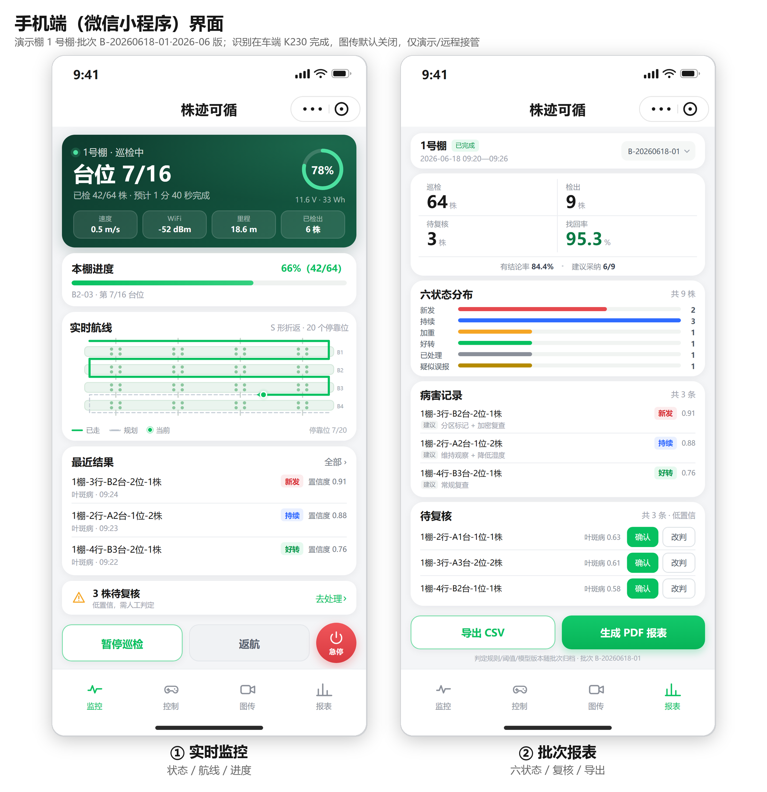
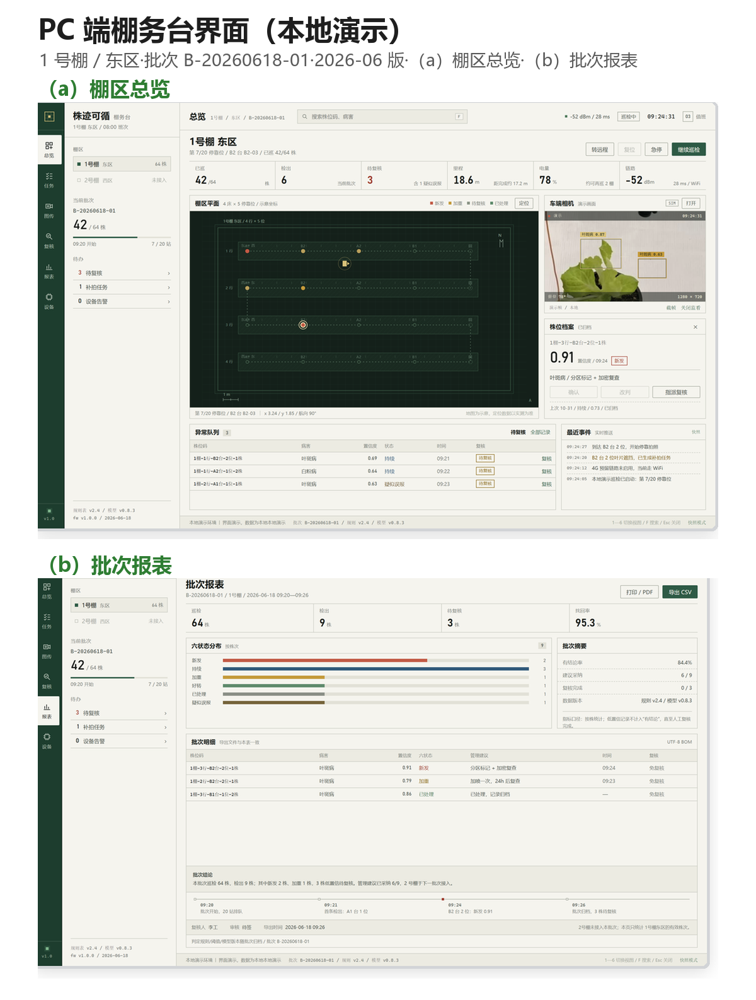

# 08 · 软件与演示

## 1. 软件栈总览

| 端 | 技术 | 入口 | 说明 |
|---|---|---|---|
| 本地服务 | Python 3.12 标准库（无第三方依赖） | `code/demo/server/app.py` | 仿真、HTTP API、WebSocket、CSV 导出、设备接入 |
| 手机端 H5 | 原生 HTML/CSS/JS | `code/demo/web/index.html` | 4 个 tab：监控 / 控制 / 图传 / 报表；可离线打开 |
| 微信小程序骨架 | WXML/WXSS/JS | `code/demo/miniprogram/` | 可导入微信开发者工具；4 页 + API 层 + BLE 骨架 |
| PC 棚务台 | 原生 HTML/CSS/JS | `code/demo/web_pc/index.html` | 桌面控制台：棚区平面、株位档案、复核、报表、图传 |
| K230 设备端 | MicroPython（CanMV） | `code/demo/firmware/k230/` | 图传上行、MJPEG 服务、YOLO11n kmodel 推理 |
| 设备模拟器 | Python | `code/demo/tools/device_simulator.py` | 无硬件时模拟推帧 + 遥测 + 检测框 |

## 2. 一键演示

```bash
cd code/demo
python server/app.py
```

打开：

- 手机端：<http://127.0.0.1:8765/>
- PC 棚务台：<http://127.0.0.1:8765/pc/>

Windows 可直接双击 `启动演示.cmd` / `启动PC演示.cmd`。

### 演示动线（约 3 分钟）

| 步骤 | 操作 | 要讲的点 |
|---|---|---|
| 1 | 打开「监控」 | 台位 7/16、电量、S 形航线、最近结果；点「暂停巡检」 |
| 2 | 切「控制」→ 远程模式 | 摇杆、遥测、急停；说明真机阶段走 BLE，遥控器优先 |
| 3 | 打开「图传」 | K230 实拍/检测框、LIVE、低码率；说明默认关闭、识别在车端 |
| 4 | 打开「报表」 | KPI、六状态分布、待复核确认/改判、导出 CSV |
| 5 | 收尾 | 「手机端与本地联调完成，车端推流与控制接口已预留，二期接实车」 |

<div align="center">

<br><em>图 11 手机端界面：实时监控与批次报表</em>
</div>

<div align="center">

<br><em>图 12 PC 端棚务台：（a）棚区总览；（b）批次报表</em>
</div>

## 3. 本地服务接口

| 接口 | 方法 | 说明 |
|---|---|---|
| `/api/state` | GET | 当前任务、台位、电量、链路状态 |
| `/api/report` | GET | 批次报表（KPI、六状态分布、待复核） |
| `/api/export/csv` | GET | 导出批次记录（UTF-8 BOM，Excel 可直接打开） |
| `/api/records` | GET | PC 台账 |
| `/api/camera/status` | GET | 图传源状态（sim / push / mjpeg / rtsp） |
| `/api/camera/latest.jpg` | GET | 最新一帧（小程序轮询用） |
| `/api/camera/stream.mjpg` | GET | MJPEG 流（H5 用） |
| `/ws` | WebSocket | 状态推送、复核、模式切换、图传开关 |
| `/api/device/frame` | POST | K230 推帧（raw JPEG） |
| `/api/device/detection` | POST | K230 上报检测结果 |
| `/api/device/telemetry` | POST | 真车遥测覆盖仿真（3 s 超时回退） |
| `/api/device/commands` | GET | 控制下行队列 |
| `/api/device/ack` | POST | 设备确认 |

完整契约见 [`code/demo/docs/api_contract.md`](../code/demo/docs/api_contract.md) 与 [`code/demo/docs/K230_实时图传_API.md`](../code/demo/docs/K230_实时图传_API.md)。

## 4. 图传：三种接入方式

| 方式 | 链路 | 适用 |
|---|---|---|
| **A · push（推荐）** | K230 `POST /api/device/frame`（raw JPEG，3—5 fps）→ 服务端转 MJPEG → H5 | 联调、演示 |
| **B · mjpeg 直连** | K230 自建 MJPEG 服务 `http://<K230>:8080/stream`，服务端/页面直连 | 最低依赖 |
| **C · rtsp** | K230 推 H.264 RTSP（720p/15fps），服务端 ffmpeg 拉流拆帧 | 正式低码率（约 1.2 Mbps） |

> 图传只用于监看与远程接管，**默认关闭、不参与判定**；识别始终在车端 K230 完成，不上传原始视频。

无硬件时：

```bash
python tools/device_simulator.py --port 8765 --fps 3
```

模拟器会推帧 + 遥测 + 检测框，用于验证整条链路。

## 5. PC 棚务台

`code/demo/web_pc/` 是给值班室用的桌面控制台，不是手机界面放大版：

- 左侧棚区 / 批次 / 待办；中间棚区平面（机器人位置、20 个停靠位、64 株刻度、异常点）；右侧车端相机与株位档案；底部异常队列与事件流。
- 六个视图：总览、任务、图传、复核、报表、设备；快捷键 `1—6`、`F` 搜索、`Esc` 关闭。
- 设计取向：深绿导轨 + 纸张灰工作区 + 黄铜状态点；直角面板、细线、DIN 风格数字；不用渐变/玻璃拟态/彩色大圆角卡片。

## 6. 微信小程序骨架

`code/demo/miniprogram/` 提供可导入微信开发者工具的 4 页工程：

- `pages/monitor` 监控、`pages/control` 控制、`pages/video` 图传、`pages/report` 报表；
- `utils/api.js` 封装 HTTP/WebSocket；`utils/ble.js` 预留 BLE 控车；
- 无服务端时使用内置 mock 数据，保证页面可看。

**边界**：真机 BLE 控车、HTTPS 合法域名、`live-player` 类目资质属于二期；本期交付源码骨架 + 本地联调。小程序控车只在「远程模式」开放。

## 7. 代码质量与自测

| 项 | 结果 |
|---|---|
| 服务端自测 | PASS 51/51、WS 9/9、整圈仿真通过 |
| H5 四页 | 390×844@3x 截图，控制台 0 报错、无滚动条 |
| 小程序静态校验 | JSON/WXML/WXSS/require 引用 0 错误；Node 桩运行时 60/60 断言通过 |
| K230 板端 | 检测框正常显示；连续 120 帧无异常（固件 v1.4.3） |

## 8. 目录

```
code/demo/
├─ server/         # 本地服务（Python 标准库）
├─ web/            # 手机端 H5
├─ web_pc/         # PC 棚务台
├─ miniprogram/    # 微信小程序骨架
├─ firmware/k230/  # K230 图传 + 检测固件
├─ tools/          # 设备模拟器、截图、自测脚本
├─ assets/         # 演示素材（车端相机画面等）
├─ docs/           # 接口契约、K230 图传 API、PC 端说明
├─ shots/          # 手机端高清截图
├─ shots_pc/       # PC 端高清截图
└─ 株迹可循-手机端演示.html  # 单文件离线演示版
```
