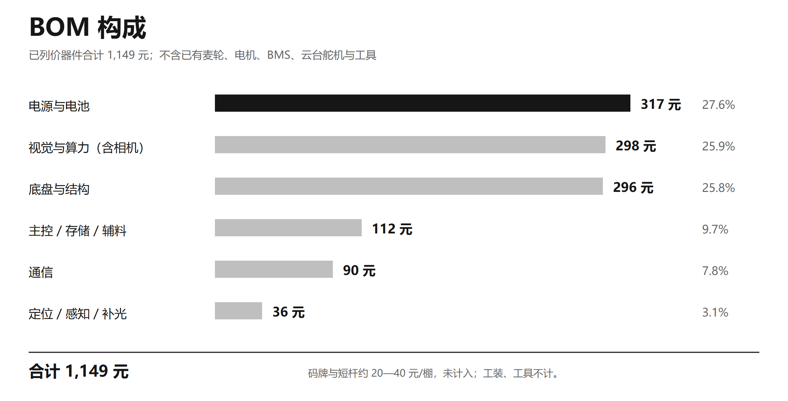

# 09 · 适用场景、成本与商业模式

> 本页是产品与商业侧的**测算与判断**，不是销量与市占率承诺。所有数字都标注口径；没有公开价格锚点的地方，明确写「无公开数据」。

## 1. 目标场景

| 维度 | 定位 |
|---|---|
| 棚型 | 台架式 / 垄作小型温室 |
| 作物 | 矮脚上海青（当前版本） |
| 客户 | 50 亩以上叶菜基地、园区、合作社、农服组织 |
| 痛点 | 巡检频次高、人工在高温高湿环境重复行走、病害发现靠经验、复查难追溯 |
| 不适用 | 露地/坡地、全病害、早期无症状、自动施药、无人值守 |

## 2. 成本结构

| 项 | 金额 | 说明 |
|---|---|---|
| 新增已列价器件 | **1,149 元** | 非整机 BOM；不含已有麦轮/电机、BMS、云台舵机、结构件与工具 |
| 码牌与短杆 | 约 20—40 元/棚 | 演示棚 32 张，未计入 1,149 元 |
| 整机目标售价 | **≤ 1.8 万元/台** | 目标值，不是已实现售价 |

<div align="center">

<br><em>图 8 已列价器件构成（合计 1,149 元，非整机 BOM）</em>
</div>

### 价格参照（量级参考，不是竞品市场价）

| 参照物 | 价格 | 说明 |
|---|---|---|
| 同功能教学实训整机 | 约 18.9 万元/台 | 含教学配套，**不是农业生产市场价**，只作量级参考 |
| 轨道运输车 | 约 2,000 元/台 | 只有运输，无识别/定位/建议 |
| 手机识别 App | 近乎免费 | 没有位置主键，无法跨次找回 |

本作品目标售价约为教学实训整机的 1/10，同时比轨道运输车多了识别、单株定位、跨次复查与建议能力。

## 3. 单位经济模型

### 3.1 单台年净收益

按 4 年折旧、年运维 0.20 万元、年可挽回损失与替代巡检工费合计 0.65 万元：

```
N = 6,500 − 2,000 − P / 4    （元，P 为整机售价）
```

| 售价 P | 年净收益 N |
|---|---|
| 2.2 万元 | −1,000 元 |
| 2.0 万元 | −500 元 |
| 1.8 万元 | 0 元 |

**结论：10 亩级小主体自购整机基本不盈利。** 按同参数外推，50 亩需 5 台，年净收益约 −5,000—0 元——**单靠整机零售不成立**。

### 3.2 服务模式

所以主路径是「**整机 + 按亩/按棚次服务**」：

| 项 | 数值 |
|---|---|
| 服务计价 | 120 元/亩·年 |
| 10 亩年服务收入 | 1,200 元 |
| 年运维成本 | 400 元 |
| 单台年毛利 | 约 800 元 |
| 50 亩（5 台）年毛利 | 约 4,000 元 |

> 服务模式的毛利需要以规模、配件与数据服务覆盖人工成本；**测算不是承诺**。六个关键参数（工价、可挽回损失、支付意愿、真实采购价、补贴、续费率）需按调研与实测取值。

## 4. 三种合作方式

| 方式 | 标的 | 计价口径 |
|---|---|---|
| **技术许可** | 单株档案 + 五级株位码的定位与找回方法、多视角拍照与补拍状态机、六状态判定阈值表、管理建议规则表、车端/PC/手机端部署方案 | 入门费 + 按台提成（参考：入门费 1—2 万元/年，按出厂价 3%—5% 提成，按激活台数季度对账、年度封顶，许可期 3—5 年） |
| **合作开发** | 按研发投入分摊 + 收益分成 | 人月台账分摊研发投入；收益分成比例不超过 30%、分成期不超过 3 年；知识产权「谁投入、谁拥有，共有须书面约定」 |
| **按亩/按棚次服务**（主路径） | 硬件作为服务载体，不做整机零售 | 元/亩·次 或 元/棚次；以合同面积与系统生成的巡检批次报表计量；计价基准不高于当地同路线、同株数人工巡检成本的 70% |

以上报价以整机目标售价 ≤ 1.8 万元/台、单台覆盖约 10 亩、已列价新增器件约 1,149 元的测算为锚；**不预设销量与市占率**，具体金额、期限与验收标准在合同中约定。

## 5. 推广路径

```
2027 年：2 个棚示范
   ↓
农服组织按亩/按棚次代运营
   ↓
与保险 / 绿色防控项目捆绑
   ↓
对接供销社、农技驿站等渠道
```

## 6. 风险与不做的事

| 风险 | 应对 |
|---|---|
| 单机零售不成立 | 明确以服务为主路径，不承诺整机销量 |
| 无公开价格锚点 | 不写「市场容量 X 亿元」，只做三种情景测算 |
| 支付意愿未调查 | 参数标注来源与缺口，不夸大回本周期 |
| 单一作物/少量病害 | 主动写入边界，跨季跨品种继续验证 |
| 与大型智能温室竞争 | 不改造温室、低成本、可换棚，走差异化 |

> **本页所有数字均为测算或量级参考**，不构成对客户、投资人或评审的收益承诺。
