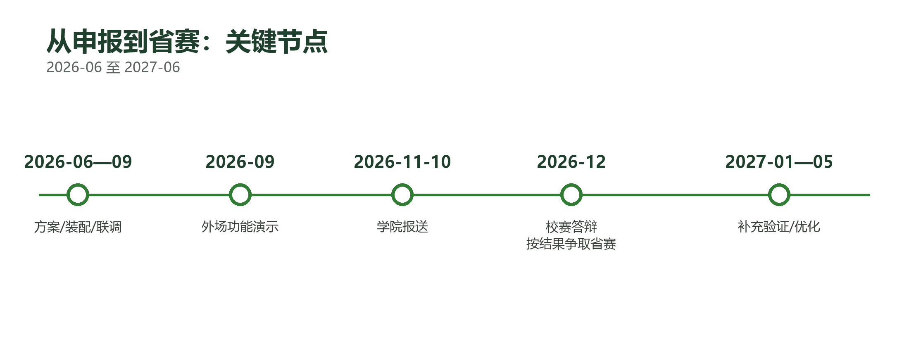

# 12 · 研发历程与后续计划

## 1. 里程碑

| 时间 | 阶段 | 交付 |
|---|---|---|
| 2025 | 前期积累 | 轻量化叶病检测方法研究；EI 论文（AIAHPC 2025）发表，形成算法基础 |
| 2026-06 | 方案定稿 | 明确「一株一档」主线；确定整机五块、六状态口径与验收指标 |
| 2026-07 | 器件选型 | 底盘、主控、视觉、通信、电源选型与采购 |
| 2026-08 | 样机装配 | 整机装配、线束、云台与结构件 |
| 2026-09 | 整机联调 | 逐台位停靠拍照、同一台位重复停靠 10 次流程验证；**2026-09-18 外场功能演示**（整机行走、图传、图像采集） |
| 2026-10 | 数据与软件 | 数据集管线、按原图分组重划分、六状态规则、PC/手机端演示、K230 图传与板端推理 |
| 2026-11 | 交付与整理 | 代码附件、演示材料、文档体系；本仓库脱敏整理与开源 |

 <em>图 10 从立项到外场验证的关键节点</em>

## 2. 版本演进（工程视角）

| 阶段 | 重点 | 结果 |
|---|---|---|
| V1—V3 | 方向调研与选题 | 从多个农业机器人方向中收敛到「单株档案 + 跨次复查」 |
| V4—V8 | 方案与文档成型 | 整机五块、航线、定位、六状态框架建立 |
| V9—V13 | 指标与论证打磨 | 按日期划分、按株统计、参考文献与对比框架 |
| V14—V18 | 整机与软件联调 | K230 图传、PC 棚务台、手机端、小程序骨架 |
| **V19（当前）** | 演示与交付 | 手机端/PC 端界面、数据管线、K230 板端 kmodel、文档与代码附件 |

## 3. 后续计划

### 二期（近期）

| 任务 | 验收 |
|---|---|
| 微信小程序真机联调（HTTPS 域名、BLE 控车） | 真机 4 页与 H5 一致；BLE 近场控车 + 急停 |
| ESP32-C3 固件补 BLE GATT 与 Wi-Fi TCP 桥 | 手机真机控车；失联 500 ms 停车 |
| K230 推流（MJPEG 720p/15fps → HLS） | 图传延迟 ≤ 1 s；1 小时流量与续航记录 |
| 自采跨日期数据微调 | 按日期划分的按株指标复测 |

### 三期（中期）

- 侧下视机位补叶背；
- 多品种（生菜、小白菜等）与更多病害类型；
- 跨季、跨棚泛化验证；
- 服务化试点（按亩/按棚次）。

### 长期

- 与农服组织、供销社、保险/绿色防控项目合作；
- 数据服务（批次档案、病害趋势）作为增值项。

## 4. 开源计划

| 内容 | 状态 |
|---|---|
| 视觉端/服务端/上位机/移动端代码 | ✅ 已开源（本仓库） |
| 算法与数据管线 | ✅ 已开源（公开数据部分） |
| 设计图与文档 | ✅ 已开源 |
| 车端 STM32/ESP32 固件 | ⏳ 整机侧维护，评估中 |
| 训练权重 | ⏳ 未分发，提供复现脚本 |
| 自采温室数据 | ⏳ 涉及场地与授权，暂不公开 |

## 5. 经验与教训

1. **先把主键定下来。** 「一株一档」不是包装，而是让所有指标、建议、复查能落到同一对象上的前提；没有主键，后面全是平均分。
2. **数据泄漏比模型选择更影响结论。** 公开数据集 69% 的增强副本跨集，按原图分组重划后指标才可信。
3. **窄口径不是缺点。** 单作物、少量病害、已显症，换来的是可验收、可复现、可讲清楚边界。
4. **演示系统要能兜底。** 断网、无硬件、网络受限时，本地演示包与设备模拟器保证演示不翻车。
