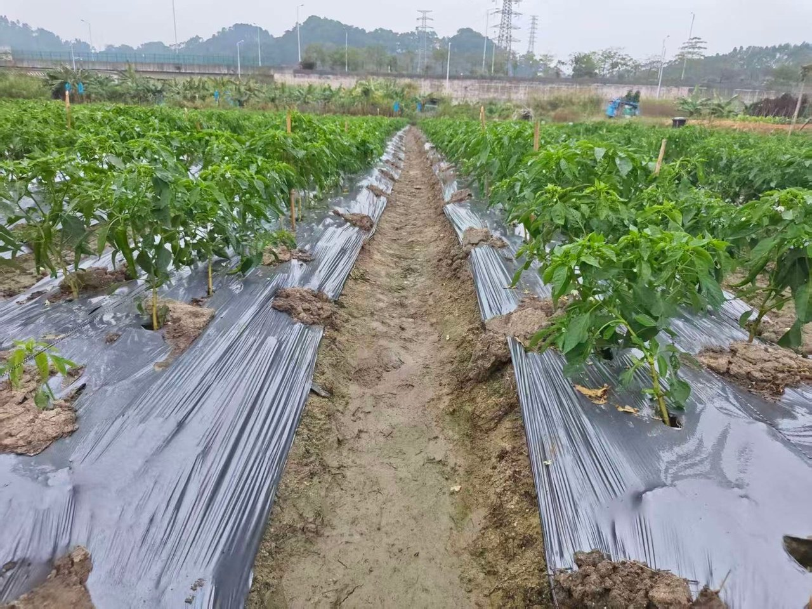
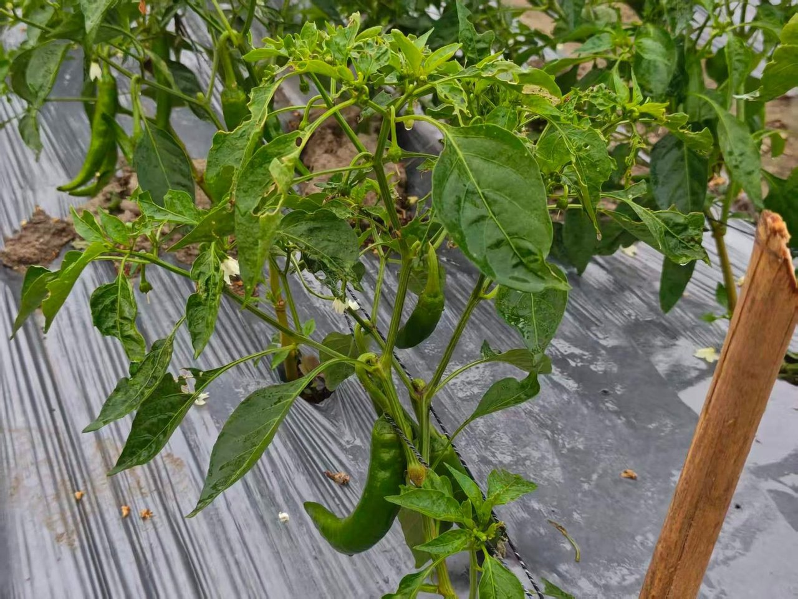
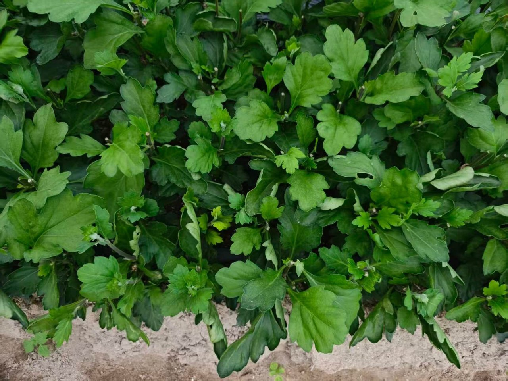
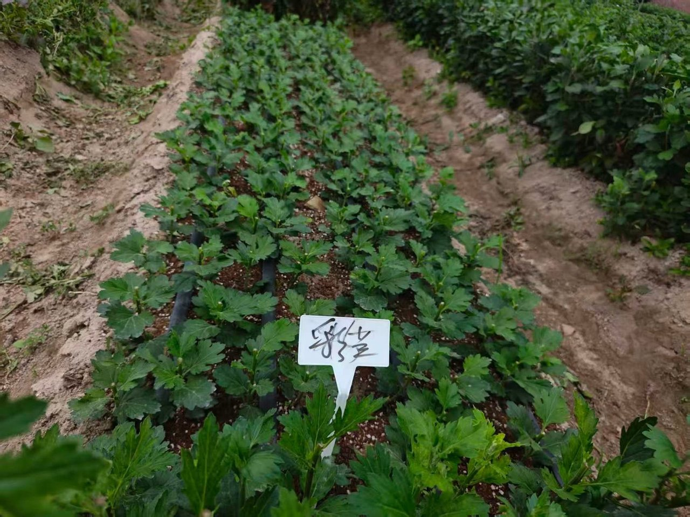
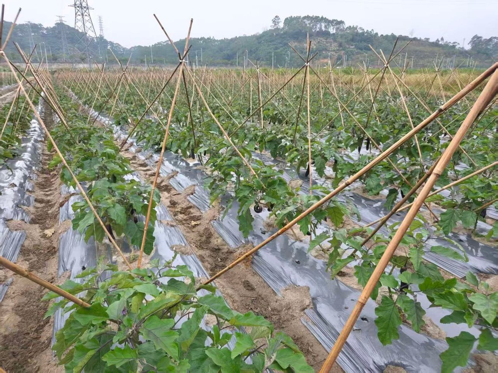

# 14 · 增城种植园实地记录（2026-11）

> 本页记录 2026 年 11 月在广州增城一处种植园完成的场地与成像条件踏勘。
> 目的是验证「不改造温室、可换棚」的适用性前提：**场地能不能进、作物与垄型是否可行、成像条件（反光/遮挡/光照）是否在可控范围**。
> 本页**只作场地适配记录，不产生任何精度数字**；整机作业与检测证据见 2026-09 外场功能演示与项目检测视频（不随本仓库分发）。

## 1. 场地与作物

| 场景 | 种植方式 | 对巡检的影响 |
|---|---|---|
| 露地辣椒种植区 | 地膜覆盖、垄沟栽培、行距约 0.6—0.8 m | 地膜反光强、垄面不平整；适合验证「低矮作物 + 窄行」的贴地巡检 |
| 叶菜苗床 | 密植、连片苗床 | 单株边界不明显，依赖株位码才能落到「株」 |
| 苗床幼苗（滴灌带） | 2—3 叶期、滴灌带布设 | 植株小、遮挡少，适合近景成像与 GSD 记录 |
| 温室大棚 | 连片苗床 + 遮阳网 + 滴灌 | 棚内光照均匀但照度低，需自动曝光；网架高度限制云台抬升 |
| 茄子搭架区 | 竹架吊蔓、行距较大 | 支架与吊绳形成遮挡，考验航线与视角规划 |

 <em>图 14-1 露地辣椒种植区：地膜覆盖、垄沟栽培，远处为输电塔与丘陵（2026-11，增城）</em>

 <em>图 14-2 辣椒植株与果实近景：挂果节位与叶片遮挡关系</em>

 <em>图 14-3 叶菜苗床：密植条件下单株边界弱，是「一株一档」要解决的核心场景</em>

 <em>图 14-4 苗床幼苗（2—3 叶期）与滴灌带</em>

 <em>图 14-5 茄子搭架种植区：竹架与吊绳遮挡，考验航线与视角规划</em>

## 2. 观察与判断

1. **场景多样性成立**：同一园区里露地覆膜、密植苗床、温室棚、搭架作物并存，说明「码牌带走、不改造温室」的换棚思路有现实基础。
2. **成像难点集中在三处**：地膜强反光、棚内低照度、支架/吊绳遮挡；对应到方案里是自动曝光、补拍状态机与多角度航线，而不是靠单一顶视。
3. **落「株」仍然必要**：密植苗床上肉眼也难分单株，株位码是把检测框变成「这一株」的唯一稳定方式。
4. **边界**：本次只是场地踏勘与作物记录，没有布设码牌、没有按株找回与六状态复判，因此不产生精度结论。

## 3. 影像说明

- 照片为现场手机拍摄，已去除元数据（不保留 GPS/设备信息）；画面内无人员、无园区标识；
- 现场另有两段短视频（8.4 s / 7.8 s）记录作物与苗床，因无整机画面，未放入本仓库，可在项目材料中查看。

## 4. 与「外场功能演示」的区别

| 项目 | 2026-09-18 外场演示 | 2026-11 增城记录 |
|---|---|---|
| 内容 | 整机行走、图传、图像采集 | 场地、作物与成像条件 |
| 证据形态 | 现场照片 + 检测视频 | 现场照片 |
| 结论 | 整机能到场、能跑、能成像 | 场地可行、成像难点已识别 |
| 精度 | 不作精度结论 | 不作精度结论 |
